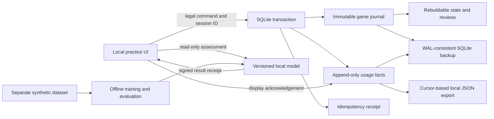

# Fast assessment and preserved usage data

The app has two separate learning loops. A small model provides near-instant predictions of the existing conditional bot analysis. Real learner activity is preserved locally so a future personalization model can study sequences of decisions and what feedback preceded them. Synthetic examples never count as usage, and usage is never automatically fed back into training.

## Current fast model

Open **Bot table → Quick assessment**, choose an action and assess it without betting. The model supports a fresh two-player opening decision with the learner on the button, 100 BB starting stacks, policy-2 Mara, no previous public actions/nonzero player reads, and fold/call/raise-to-20/raise-to-25 choices. Other decisions retain **Show move hint** and the existing detailed analysis. The normal app needs no Python, network or external solver for inference.

The target is whether the authored detailed teacher establishes a statistically clear higher-return tested alternative. A negative includes inconclusive teacher comparisons. It is not an assessment of optimal play, a winning probability or a general poker-skill score.

The reviewed model uses 10,000 synthetic candidate rows from 2,500 distinct deals. All four choices from a deal stay in the same split. Training uses 8,000 rows with a 200-world teacher; disjoint validation deals use independently sampled 640-world analysis for calibration and per-choice abstention thresholds. The initial diagnostic test revealed weak folding results hidden by aggregate numbers; thresholds were refined on validation and final evaluation used 250 entirely new deal groups / 1,000 candidate rows. Those final groups never enter fitting, calibration or threshold selection.

| Fresh final 640-world teacher comparison            | Result                                          |
| --------------------------------------------------- | ----------------------------------------------- |
| Decisive prediction coverage                        | 53.7%                                           |
| Agreement among decisive predictions                | 95.53%                                          |
| Deal-bootstrap 95% range for that agreement         | 93.61–97.22%                                    |
| Brier score, model / logistic / prevalence baseline | 0.1117 / 0.1550 / 0.2277                        |
| Pure model inference median / p95                   | approximately 0.008 / 0.012 ms                  |
| Independent local HTTP + SQLite median / p95        | 0.696 / 1.028 ms, 200 requests after 20 warmups |

The current release returns decisive **no clear gap** predictions only. It always abstains on folds and has no validated positive-gap detection threshold. The remaining cases show uncertainty and direct the learner toward detailed analysis. Even a decisive answer is fallible: approximately 4.5% of those final predictions disagreed with the teacher. The confidence ranges measure performance against this synthetic teacher distribution, not human poker accuracy. Precision across candidates from a deal is correlated; the report supplies deal-bootstrap intervals.

The teacher's median allocated cost was approximately 57 ms per candidate for the 640-world synthetic benchmark, which evaluates four candidates jointly. HTTP timings and teacher timings have different boundaries. The fast endpoint is an additional cheap assessment; ordinary action submission and full reviews still run their existing detailed analysis. No claim of equivalent end-to-end gameplay speedup is made.

See the [model card and reproduction commands](../packages/poker/models/README.md) and [machine-readable evaluation](../packages/poker/models/fast-assessment-report.json). Scripts validate synthetic provenance, teacher/feature versions, complete candidate groups and frozen splits; interrupted final groups can be repaired. The artifact is JSON evaluated in TypeScript, not an executable Python pickle. Retraining and model promotion are explicit offline steps. A policy, support, feature or teacher change requires a new version and evaluation.

## Storage architecture



SQLite is the durable source of truth; browser storage holds pointers, preferences and a pseudonymous session ID. It uses WAL, foreign keys, a 5-second busy timeout and explicit `synchronous=FULL` so accepted transactions request disk durability, rather than depending on a library compile default. Hardware/filesystem behavior remains relevant; a local file is not a backup of itself. The [SQLite online backup API](https://sqlite.org/backup.html) copies committed WAL state into a consistent snapshot.

### Usage records and provenance

Migration 11 creates an installation UUID, a private signing secret, session records and immutable usage events. Migration 12 upgrades early schemas transactionally, preserving all rows, timestamps and the highest export cursor even if earlier rows were deleted. Schema gating occurs inside an immediate transaction so concurrent startup cannot both perform the upgrade.

Each usage event has a monotonic cursor, schema version, server timestamp, installation/session IDs, table ID, source revision, event ID, kind and allowlisted payload:

| Fact                 | Meaning                                                                                                                                                                                          |
| -------------------- | ------------------------------------------------------------------------------------------------------------------------------------------------------------------------------------------------ |
| `decision-viewed`    | The UI acknowledged showing an active decision. A session/decision pair is deduplicated by the client; the server rejects stale new acknowledgements.                                            |
| `assessment-shown`   | The UI acknowledged displaying a server-issued assessment receipt. It records the tool/model ID, candidate action/size when applicable, prediction and receipt issue time.                       |
| `decision-committed` | A legal accepted hero action, exact journal sequence, hand/attempt provenance and its public decision-time features. Written inside the same transaction as gameplay, labels and retry receipts. |

Event identity is `(table_id, event_id)`, matching the existing per-game action-ID contract. A request retry creates no second choice or usage fact. Any usage write failure rolls back the action too; the user can retry with the same command ID. A viewed/exposure acknowledgement failure does not block play: the UI offers recording retry, and assistance remains unknown rather than being guessed.

The source is `human-ui` when a client supplies a valid session identifier and `api-unknown` when it does not. These are client-origin indicators, not authenticated identities or proof a human is present. No accounts, IP addresses, device fingerprinting or external collection are added. The installation ID is pseudonymous, not anonymous. This is currently one local installation/learner; hosted, multi-user collection would need explicit identity/consent and access boundaries.

The decision payload stores hero cards, visible board, street, pot, call price, stack, competing-opponent count, dealer, public history, chosen action and journal linkage. It excludes actual opponent holes, future board, seed, hindsight odds and final outcomes. Full private game state remains in the existing server-side journal, the current `bot_tables.state` projection and full backups. Public features are useful for ML but are still personal practice records.

### Exposure and timing semantics

A prediction request is a read-only calculation. It creates no activity row. The response carries a signed receipt, and the UI acknowledges that receipt after rendering the result. HMAC verification prevents changing the recorded model prediction or candidate in the acknowledgement. The signature proves what the server issued; client acknowledgement reports display and is not evidence the learner understood it.

Fast assessments, move hints, odds and opening guides are instrumented. Some other study aids, including the separate Decision Assistant panels and optional solver charts, are not yet fully instrumented. Missing acknowledgements therefore always mean **unknown assistance**, never independent play. Known exposure requires an acknowledgement from the same session/revision before the choice's committed cursor. Late acknowledgements are preserved but do not retroactively count as known pre-choice exposure.

Server view/choice timestamps allow analysis of observed view-to-submit wall time. That includes idle time and network scheduling; it is not a direct measurement of thinking time. Client session identifiers distinguish visits when different; copied/opened tabs can inherit a session ID and are not guaranteed separate identities. Replays, branches, restarted attempts and partial legacy decisions carry practice/provenance flags, enabling exclusion from independent personalization examples. Fresh ordinary next hands can become independent candidates again. No current usage metric is promoted into a poker-skill score.

## Retention, export and recovery

Open **Bot table → Local practice data** for local counts, export, backup and usage deletion. Data remains on the device until an explicit deletion; there is no silent expiry and no upload endpoint.

- **Usage JSON export** is paged and ordered by cursor. The first response freezes an upper cursor; subsequent pages pass the same `through` value. Events inserted afterward belong to the next export. Intentional deletions during export remain deletions. Stable `(installation ID, table ID, event ID)` keys support downstream deduplication; cursor alone is scoped to that database lineage.
- **Full backup** uses SQLite's online snapshot API, validates integrity and foreign keys, writes private temporary files, and removes server-side download staging after the response. It includes all local tables, private hand history, sessions, labels, idempotency receipts and signing identity. Keep downloaded copies private. A browser download is standalone SQLite; its SHA-256 is also returned in an HTTP header.
- **CLI backup** additionally creates a manifest containing checksum, byte size, schema version, timestamp and row counts. It syncs snapshot/manifest bytes and the output directory before success. Existing main files, manifests or WAL/SHM sidecars cause refusal, preventing accidental overwrite or contamination by another database's WAL.
- **Restore** accepts a consistent standalone snapshot or checks its sidecar manifest when present, validates SQLite/app identity/integrity/foreign keys, and publishes to a new path only. It never overwrites a live database or automatically restores old data on startup. Restore uses a private stream copy and checks existing main/WAL/SHM destinations.
- **Delete game** cascades its usage and decision history. **Clear usage records** removes usage/session records and rotates installation/signing identity, while preserving saved games and their separate game journal/datasets. Consequently old signed exposure receipts cannot repopulate cleared usage. Previously downloaded/exported copies are user-owned files and must be deleted separately if desired.

Backups are user-triggered rather than silently retaining deleted data in rotating copies. To protect against loss of the device/disk, copy the downloaded snapshot to storage you control separately. A versioned export is suitable for analysis; a full SQLite snapshot is the recovery path for continuing practice.

```sh
npm run data:backup -- --source data/poker.sqlite --output /your/private/backup.sqlite
npm run data:restore -- --source /your/private/backup.sqlite --output data/restored.sqlite
POKER_DB=data/restored.sqlite npm run dev
```

Both destination paths must be new. CLI backup opens the source read-only and performs no migrations. Test a restore into a separate path before relying on a backup. [VERIFY.md](../VERIFY.md) contains the commands and current [PROGRESS.md](../PROGRESS.md) records observed checks.

## Future personalization

The next pipeline can consume explicit human-origin exports, join choices to versioned teacher labels by table/journal sequence, assess telemetry completeness, and group validation by learner/session/original deal. Keep observed actions, assistance, teacher labels and model predictions separate; a model's own prediction must not become ground truth. Data augmentation or replay must retain its origin. Exclude uncertain teacher labels or model them explicitly rather than silently turning them into mistakes/correct answers.

This release collects bot-table views, instrumented feedback displays and committed decisions. Existing drills/lessons keep their current answer/hint tables and are preserved in full backups; they are not automatically rewritten as usage events. Future hosted collection can use an idempotent export-ingestion boundary and explicit opt-in, then add user-level isolation and evaluation. The present app performs no cross-device collection and trains on no real usage automatically.
